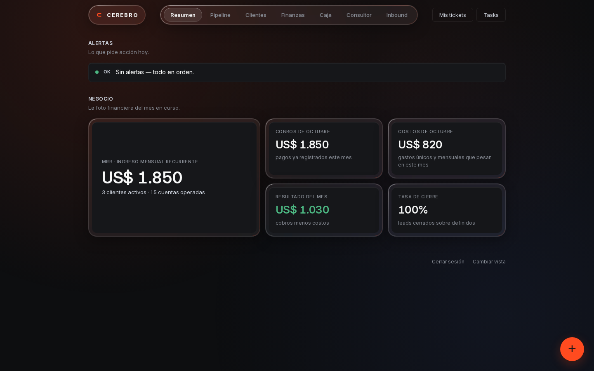

# Segundo cerebro para negocios chicos

Un tablero para seguir clientes, ventas, cobros, gastos y tareas. Incluye navegación por secciones, tarjetas, pipeline arrastrable, gráficos, formularios y temas claro y oscuro según la preferencia del sistema. Se adapta al celular.

Está pensado para una persona o un equipo de confianza que comparte una instalación. Arranca vacío. Los importes se muestran en USD.



La captura usa datos ficticios; no vienen precargados.

## Qué podés hacer

- **Resumen:** ver abonos activos, cobros, costos y alertas.
- **Pipeline:** cargar prospectos, editar propuestas y arrastrar tarjetas entre etapas.
- **Clientes:** registrar abonos, fechas de inicio, renovaciones y cobros.
- **Finanzas:** ver gráficos mensuales y registrar cobros y gastos, incluidos gastos recurrentes.
- **Caja:** seguir saldos y registrar transferencias o ajustes.
- **Tasks y Tickets:** compartir pendientes y pedidos dentro del equipo.

**Consultor** usa OpenAI para responder con los datos del negocio, historial y adjuntos. **Inbound** sincroniza videos de Instagram y recibe eventos de Manychat para seguir DMs, leads, llamadas y cierres. Cada instalación configura sus propias credenciales; las conexiones vienen desactivadas. Seguí la [guía de integraciones](docs/integraciones.md).

No incluye facturación electrónica ni contabilidad fiscal.

## Empezar

Necesitás Python 3.12 o superior y soporte para `venv` (en Debian/Ubuntu, el paquete `python3-venv`). En Linux o macOS:

```sh
python3 -m venv .venv
. .venv/bin/activate
python -m pip install -r requirements.txt
python scripts/bootstrap.py
python manage.py createsuperuser
waitress-serve --listen=127.0.0.1:8000 core.wsgi:application
```

En Windows PowerShell, activá el entorno con `.venv\Scripts\Activate.ps1` y ejecutá los mismos comandos con `python`. Abrí <http://127.0.0.1:8000> e iniciá sesión. Los formularios están dentro del tablero. Creá una caja antes de registrar cobros o gastos.

`bootstrap.py` crea una clave aleatoria y una base SQLite vacía en `~/.local/share/segundo-cerebro-negocios/`. No imprime la clave. Podés cambiar la ubicación con `SECOND_BRAIN_DATA_DIR`, siempre fuera del repositorio. Volver a ejecutar el script conserva la clave y los datos, aplica migraciones y actualiza los archivos estáticos.

Configuración opcional, antes de arrancar el servidor:

```sh
export SECOND_BRAIN_NAME="Mi negocio"
export SECOND_BRAIN_TIME_ZONE="America/Argentina/Buenos_Aires"
```

El nombre predeterminado es `CEREBRO` y la zona horaria es `UTC`.

**Cambiar vista** permite elegir Personal, Gestión o Equipo. Los números 1, 2 y 3 solo cambian la presentación; no son contraseñas ni permisos. Todas las cuentas habilitadas comparten los mismos datos. El administrador en `/admin/` permite gestionar usuarios y notas.

## Cómo se calculan los números

El MRR suma abonos de clientes activos cuya fecha de inicio ya llegó. Cobros suma los registros del mes. Costos incluye gastos únicos del mes y gastos mensuales desde su fecha de comienzo. Resultado es cobros menos costos.

Cada caja parte del saldo al comenzar su fecha inicial. Los cobros, gastos y movimientos posteriores modifican ese saldo. Un gasto mensual se descuenta cada mes en su día de vencimiento; si el mes es más corto, se usa el último día. Los movimientos futuros no modifican el saldo actual.

Los gráficos muestran los registros cargados. No consultan bancos ni verifican pagos.

## Datos y copias

`db.sqlite3` contiene los datos y las cuentas de acceso. Detené el servidor antes de copiarlo y guardá la copia en un lugar privado. Para restaurar, reemplazá ese archivo con el servidor detenido. Conservá también `secret_key` si querés mantener las sesiones existentes. No subas ninguno a GitHub.

Si instalaste la primera versión con formularios de Django, ejecutá `python scripts/bootstrap.py` al actualizar. La migración copia clientes, leads, movimientos financieros y tareas al tablero. Las tablas anteriores se conservan y las notas siguen en `/admin/`. Revisá las fechas de los clientes importados: cuando faltaban, la migración usa el día de importación y lo indica en sus notas.

## Acceso y seguridad

- El servidor escucha solo en `127.0.0.1`. Las páginas y la API requieren sesión; las escrituras usan protección CSRF.
- Las contraseñas nuevas se guardan con Argon2. No se incluyen usuarios ni contraseñas predeterminados.
- La base y la clave se crean fuera del repositorio. En Linux y macOS, la carpeta tiene permisos `0700` y la clave `0600`.
- No se incluyen claves de API, datos de negocio ni telemetría. Los recursos visuales son locales. Las integraciones externas solo se conectan cuando las configurás; el Consultor transmite datos a OpenAI al enviar una consulta.
- Para acceder desde otra máquina, usá un túnel SSH: `ssh -L 8000:127.0.0.1:8000 usuario@servidor` y abrí `127.0.0.1:8000` en tu equipo. Esta configuración no está preparada para exponer el puerto directamente a internet. El webhook tiene un [receptor separado](docs/integraciones.md#publicar-solo-el-receptor).
- Actualizá las dependencias cuando salgan parches de seguridad y hacé copias privadas de la base.

Para informar una vulnerabilidad, usá un aviso privado de seguridad de GitHub. No incluyas datos sensibles en un issue público.

Hay un solo espacio de datos compartidos de negocio. Las conversaciones y los adjuntos del Consultor se separan por usuario. El aislamiento entre empresas, los permisos por rol y un despliegue público por HTTPS requieren trabajo adicional.

Código bajo licencia MIT. La tipografía Inter se distribuye bajo SIL Open Font License; su licencia está en `brain/static/ui/fonts/OFL.txt`.
